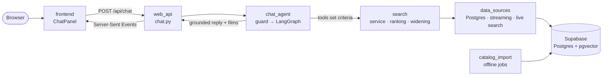

# CineSense architecture

CineSense finds films by mood. A Next.js frontend talks to a Python backend; the backend's chat agent turns a
free-text wish into search criteria, and a deterministic search over a real catalogue (Supabase Postgres + pgvector)
returns the films. This page is the map: what lives where, how one request flows, and where to start reading.

## Repository

| Folder | What it is |
|---|---|
| `backend/` | Python 3.12, FastAPI, LangGraph. The package `cinesense/` and its tests (`tests/`, same folder names). |
| `frontend/` | Next.js (App Router), TypeScript, Tailwind. The cinema UI, the chat and the technical view `/tech`. |
| `database/` | `schema.sql` (all tables in the `cinesense` schema) and the project's own local Supabase (`supabase/`). |
| `evaluation/` | The 61 evaluation scenarios, every run's raw results and the current `REPORT.md`. |
| `docs/` | The grading briefs (`brief/`) and the presentation outline (`presentation.md`). |

At the root: `Makefile` (every command: `make up`, `make test`, `make eval` …), `docker-compose.yaml` with
`nginx.conf` (one address for API and UI), and `.env.example`.

## One chat request, end to end

The model only decides **what** to search for (tags, filters, plot query, person, title). Ranking, filters, the
widening of a thin search, API budgets and the grounding check are deterministic code, so results are
reproducible and the reply can only name films the search returned.

## Backend roles (`backend/cinesense/`)

Each folder is one role. Read them top to bottom: each builds only on the ones above it.

| Role | Responsibility | Key files | May import |
|---|---|---|---|
| `core/` | Shared vocabulary, no I/O: films, search criteria, the six mood worlds, tag relevance, settings | `criteria.py`, `models.py`, `worlds.py`, `tag_relevance.py` | — |
| `data_sources/` | Adapters to everything outside: the Postgres catalogue (and an offline JSON fixture), streaming availability, live title search, Wikidata, Wikipedia, embeddings, YouTube | `postgres.py`, `streaming.py`, `live_search.py` | core |
| `search/` | Turns `SearchCriteria` into ranked, explained results; widens a search that finds too little | `service.py`, `ranking.py`, `widening.py` | core |
| `taste/` | Anonymous 👍/👎 and the taste profile derived from them | `profile.py`, `feedback.py` | core |
| `catalog_import/` | Offline jobs that build the catalogue: MovieLens + Tag Genome, plots, embeddings, posters, billing, languages | `pipeline.py` | core, data_sources |
| `chat_agent/` | The LangGraph agent: injection guard, tool loop, deterministic search run, widening, grounded explanation | `graph.py`, `tools.py`, `grounding.py`, `guard.py`, `prompts.py` | core, search, taste |
| `web_api/` | The HTTP layer: catalogue and search endpoints, chat as Server-Sent Events, `/api/inspect`, taste, the per-visitor and daily turn limits | `app.py`, `chat.py`, `limits.py`, `deps.py` (wiring) | everything above |
| `evaluation/` | Scenarios against the real agent, automatic checks, LLM judge, two baseline rankers | `runner.py`, `checks.py`, `baselines.py` | everything above |

The rule in the last column is enforced by `backend/tests/test_architecture.py`: an import that points upwards
fails the test suite. The search never imports a data source; `web_api/deps.py` builds the adapters once and
passes them in, which is also how the tests swap them for offline fakes.

## Reading order for a review (about 15 minutes)

1. `core/criteria.py`: the one search state that the chat, the chips and the advanced search all edit.
2. `search/service.py` → `search/ranking.py`: candidates per signal (tags, plot RAG, people, title), then one
   weighted, explained score (`WEIGHTS`).
3. `chat_agent/graph.py`: the graph (`build_graph`) and one turn (`run_turn`); then `tools.py` (what the model may
   do), `grounding.py` (what the reply may say) and `guard.py` (what never reaches the model).
4. `web_api/chat.py`: how a turn is streamed to the browser.
5. `evaluation/` and `evaluation/REPORT.md` at the repo root: how all of this is measured.

The technical view `/tech` in the running app shows the same for one live turn: tool calls, prompts, tokens,
cost and the ranked films.

## Frontend (`frontend/`)

| Folder | What it holds |
|---|---|
| `app/` | Routes: `/` (cinema start page), `/world/[worldId]` (genre page with the stage), `/results`, `/tech`, `/credits` |
| `components/` | One folder per part of the screen: `cinema`, `atmosphere`, `home`, `chat`, `search`, `results`, `genre`, `media`, `profile`, `nav`, `ui` |
| `lib/` | API client (`api.ts`, `chat.ts`), the shared search state (`searchState.ts`, mirrors `core/criteria.py`), types (`types.ts`, mirror `core/models.py`) |
| `__tests__/` | Vitest tests |

## Extending it

| To add … | Change |
|---|---|
| a data source (e.g. another streaming API) | an adapter in `data_sources/`, wired in `web_api/deps.py`; tests mock it with `respx` |
| a tool for the agent | a method on `ToolKit` and a `@tool` in `make_tools` (`chat_agent/tools.py`), a status line in `TOOL_STATUS` (`chat_agent/graph.py`) |
| a ranking signal | a candidate source in `search/service.py` and a weight in `search/ranking.py` (`WEIGHTS`) |
| an evaluation case | a line in `evaluation/scenarios.json`; a new kind of check goes in `evaluation/checks.py` |
| a mood world | `core/worlds.py` and the mapping in `core/worlds_map.py` |
