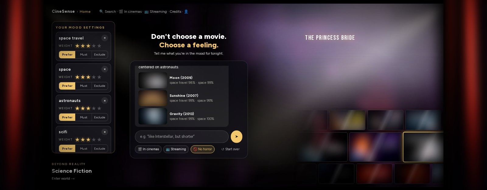
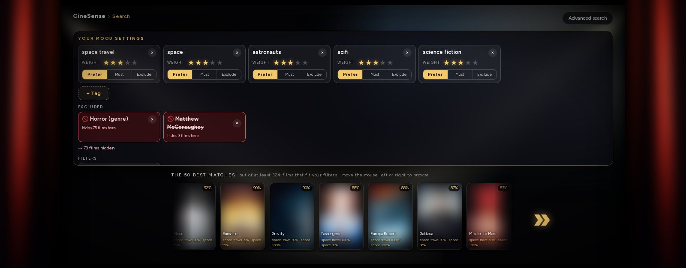
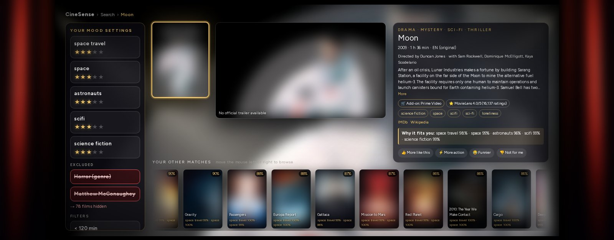
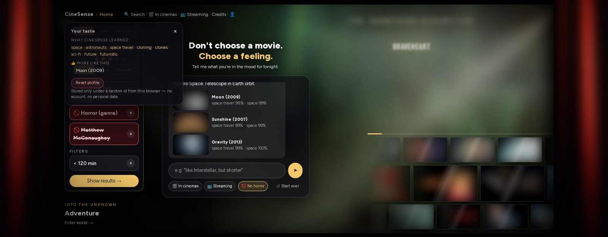
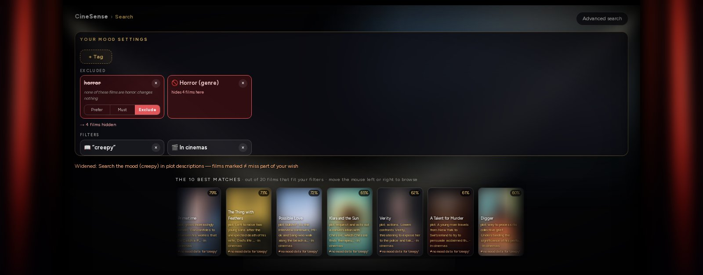
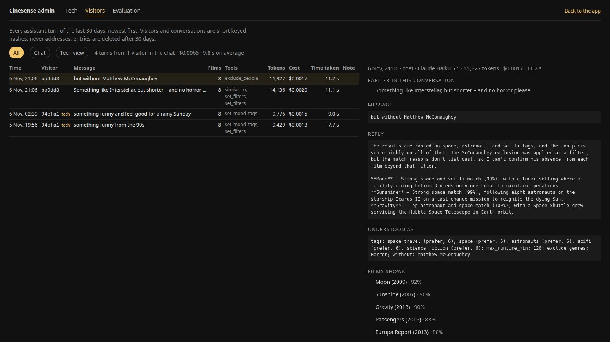
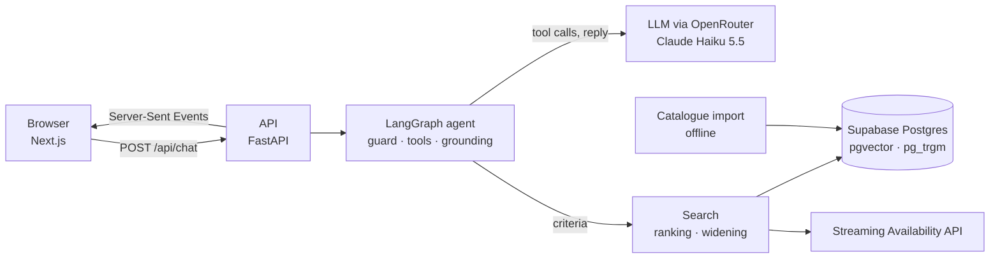

# CineSense

**Don't choose a movie. Choose a feeling.**

CineSense helps you pick a film by mood and personal wishes instead of scrolling through catalogues. You type something like *"something like Interstellar, but shorter, and no horror please"*. A chat agent turns that into visible, editable search criteria, a deterministic search ranks a catalogue of about 20,600 real films, and the reply may only name films the search returned. It also shows where each film streams in Germany and what is new in cinemas.

**Live:** [cinesense.de](https://cinesense.de) · **Showcase:** link follows (showcase.turingcollege.com) · Turing College AI Engineering capstone



<sub>Posters and film stills are blurred in all screenshots (copyright). In the app they come from the Streaming Availability API.</sub>

## Why

Cinema and streaming sites show long title lists and genre grids. A real wish usually combines several things: a mood, a length, an original language, "no horror", "on a service I have". No site lets you say that in one sentence. Sites that try it with AI often invent titles. And it all feels like a database, not like going to the movies.

CineSense answers each of these:

| Problem | CineSense |
|---|---|
| Only genre grids and lists | 1,128 mood tags per film (MovieLens Tag Genome), each weighted and set to *prefer*, *must* or *not* |
| Several wishes at once are left to the user | One sentence in the chat sets mood, filters, people, plot and exclusions together, shown as chips you can change |
| AI chats invent films | The model only chooses **what** to search for. The films come from a deterministic search, and a grounding check drops any title the search did not return |
| You don't see why a film is suggested | Every film says why it fits ("space travel 98% · plot: … · streaming on Netflix"), and excluded films are counted ("→ 78 films hidden") |
| It feels like a database | A cinema screen with curtains, mood worlds in the background, trailers on hover |

## What it does

**Chat with a mood.** The wish becomes mood chips, filters and exclusions. A follow-up such as *"but without Matthew McConaughey"* narrows the current search, and a new wish starts a new one.



**Every film on its own stage**, with poster, trailer, people, mood tags, where it streams, IMDb and Wikipedia, the reason it fits, and the next matches below.



**It learns your taste.** 👍 / 👎 build an anonymous taste profile (e.g. *space · astronauts · cloning*). Films that fit are lifted in every ranking, and rejected ones are hidden. The 👤 panel shows what was learned and resets it with one click.



**Honest when too little fits.** When fewer than three films match, the search offers counted ways to widen it, and each widened film says which part of the wish it misses (≠).



**An admin area** (`/admin`, login on the server) shows every chat turn with message, tools, tokens, cost and time, what the agent understood, and the films it showed. It also starts evaluation runs from the browser.



Also: where to watch in Germany (subscription vs. rent/buy) and recent cinema releases, typo- and sound-alike-tolerant title and person search, a live search for newer films, and trailers that start muted on hover. Full list: [docs/details.md](docs/details.md#all-features).

## How it works



One chat turn runs through a LangGraph graph (`backend/cinesense/chat_agent/graph.py`):

1. **guard:** cleans the message and blocks prompt-injection patterns (English and German) before any model call.
2. **agent:** the model calls typed tools (10 in all) such as `set_mood_tags`, `set_filters`, `search_plot`, `find` or `similar_to`, at most 6 rounds. The tools only change the search criteria.
3. **present:** the deterministic search ranks the catalogue by weighted mood tags, plot similarity, title, people, rating, popularity and the taste profile.
4. **verify:** if fewer than 3 films match, the agent gets counted widening options and picks one. If it picks none, the least intrusive one is used.
5. **explain:** the model words the reply from the films found, without tools.
6. **grounding:** the reply may only name returned films. Otherwise a template answer built from the data is used.

**The model decides what to look for. Everything that must be reproducible is code.** The full tool table and the personalisation formula are in [docs/details.md](docs/details.md#the-agent-in-detail). The repository map and a 15-minute reading order are in [ARCHITECTURE.md](ARCHITECTURE.md).

### Compared with HikeSense

The same author built a second LangGraph capstone, HikeSense (a hiking planner), with the same tools but the opposite split. CineSense is **agent-first**: the model drives a ReAct loop and builds the search criteria itself, then fixed code steps search, widen and check. HikeSense is **workflow-first**: one structured-output call parses the message and the code picks the branch, with ReAct only for knowledge questions. The diagram marks, row by row, whether the model or the code decides.


## Why it is built this way

- **Chips instead of a hidden prompt state.** Chat, chips and the advanced search all edit one search state (`core/criteria.py`). You always see and can change what the agent understood, and nothing is filtered silently.
- **Deterministic ranking, model only for intent and wording.** The same criteria give the same films. This keeps results testable and lets the evaluation compare rankers fairly.
- **MovieLens Tag Genome for mood.** Genres are too coarse for "dark, but funny". The Tag Genome scores 1,128 tags per film from real user tagging, so a mood becomes a measurable number.
- **RAG over Wikipedia plots** for wishes that are about the story ("a heist that goes wrong"). Plots are chunked, embedded and searched in pgvector.
- **pgvector and not a separate vector store (e.g. ChromaDB):** plot vectors must be combined with hard filters, mood scores, people and the taste profile in one ranked query. In Postgres that is a single SQL statement over one consistent catalogue. A separate store would need a second round trip and a merge in Python.
- **No TMDB:** its API terms forbid use in AI applications, so CineSense uses only open data and one official API (see below).
- **A fixed backend layering:** `core → data_sources → search / taste → chat_agent → web_api`. A test fails on any import that points upwards, so the search can be tested with offline fakes.
- **No account.** The taste profile hangs on a random id in the browser, so there is no personal data to protect.

## Data and why no TMDB

TMDB is **not** used: its API terms (1.C) forbid use "in connection with … an artificial intelligence (AI) based Application". Instead:

| Source | Used for | Licence |
|---|---|---|
| MovieLens (GroupLens) | ratings, genres, Tag Genome | research/education; not redistributed (read from a local file) |
| Wikidata | ids, people, runtime, language, German release, YouTube trailer ids | CC0 |
| Wikipedia | plot texts (RAG) | CC BY-SA 4.0, linked per film |
| Streaming Availability API (Movie of the Night) | streaming in Germany, posters | free plan, attribution; 1,000 requests/month with a budget guard |
| YouTube Data API (optional) | missing trailer ids | 100 searches/day, ids re-validated after 30 days |

About 20,600 films: ≈19,800 from MovieLens (incl. documentaries) plus ≈800 German releases since 2021. All sources are credited on the in-app **Credits** page, and nothing is scraped. The curtain image is based on a photo by Ambitious Studio* | Rick Barrett on [Unsplash](https://unsplash.com/photos/a-red-curtain-with-a-black-background-AwsdyjRm-kw), cropped and colour-adjusted with `frontend/scripts/make_curtain.py`.

## Evaluation

`make eval` runs 63 scenarios through the real agent and catalogue: moods, "like X, but less Y", people wanted and excluded, conflicting wishes, follow-ups, prompt-injection attacks and injected API failures. Run of 2026-11-10 (the agent's 10 tools):

| Metric | Result |
|---|---|
| Scenarios passing all checks | 59 / 63 |
| Constraint satisfaction (runtime, genres, years, people, rating …) | 32 / 32 |
| Tool selection | 51 / 52 |
| Prompt injection: 4 attacks blocked, 2 harmless AI wishes let through | 6 / 6 |
| Grounding: what the user sees names only returned films | 60 / 63 (3 template fallbacks) |
| Latency per scenario, median / p90 | 8.7 s / 15.9 s |
| Cost per chat turn (Claude Haiku 5.5) | $0.0016 |

**Ranking comparison** over 26 mood scenarios, LLM judge (Claude Sonnet 5.5, 1–5): CineSense **3.85**, movieFinder-style tag cosine 3.15, rating only 1.54. The order has been the same in every run.

Everything else, including the four failed scenarios, how to read the judge and the limits of the evaluation: [docs/details.md](docs/details.md#evaluation-in-full) and [evaluation/REPORT.md](evaluation/REPORT.md).

## Setup

```bash
cp .env.example .env          # Supabase, OpenRouter, Streaming Availability (YouTube optional)
make up                       # own local Supabase + app; first build takes a few minutes
make down                     # stops both
```

Then open **http://localhost:8080**. Three containers run: `api` (FastAPI), `web` (Next.js) and `proxy` (nginx), with the catalogue in the project's own local Supabase (Studio on http://localhost:55323). Building the catalogue (`make ingest`) runs outside Docker, because it needs the local MovieLens file.

Local development (Python 3.12 with [uv](https://docs.astral.sh/uv/), Node.js 20.19+):

```bash
cd backend && uv sync && cd ..   # backend dependencies
make db-init                     # create the cinesense schema (pgvector, pg_trgm)
MOVIELENS_DB_PATH=/path/to/moviedoc.db make ingest   # ~1.5 h, ~$0.40 embeddings; resumable
cd frontend && npm install && cd ..
make dev-api                     # FastAPI on http://localhost:8000
make dev-web                     # Next.js on http://localhost:3000
make test                        # backend (pytest) + frontend (Vitest)
```

Agent model: `anthropic/claude-haiku-5.5` via OpenRouter (`CINESENSE_LLM_MODEL` to change it). With `LANGSMITH_TRACING=true`, every turn appears in LangSmith (EU endpoint, project `cinesense`) as one trace with each node, tool call, prompt and token count. Chat limits and the admin login are described in [docs/details.md](docs/details.md#status).

## Privacy and ethics

- **No account, no personal data:** a random browser id holds the 👍/👎. The 👤 panel shows and deletes everything learned.
- **Grounding instead of invented facts:** the recommendation list always comes from the search, and unknown streaming availability is shown as "unknown", never guessed.
- **Prompt injection:** known patterns never reach the model. The real protection is the design: the model can only act through typed tools and cannot add a film the search did not return.
- **The user stays in control:** every criterion is a visible chip, vague dislikes are only *proposed* as exclusions, and hidden films are counted.
- **Known bias:** the Tag Genome covers mostly films up to about 2019 rated by MovieLens users (English-language, US and older popular cinema). Newer films are found by plot, title and people, not by mood.

Full text, including trailers, LangSmith and every limit: [docs/details.md](docs/details.md#ethics-and-privacy).

## More information

- [ARCHITECTURE.md](ARCHITECTURE.md): repository map, one request end to end, backend roles, reading order, how to extend it
- [docs/details.md](docs/details.md): all features, admin area and limits, agent tools, full evaluation, ethics
- [evaluation/REPORT.md](evaluation/REPORT.md): evaluation report and raw results in `evaluation/results/`
- [docs/presentation.md](docs/presentation.md): presentation outline
- [docs/showcase/shots.py](docs/showcase/shots.py): retakes the screenshots above (posters blurred)
- Live app: [cinesense.de](https://cinesense.de)
