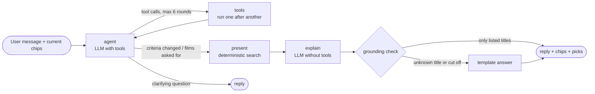

# CineSense

**Don't choose a movie. Choose a feeling.**

> Showcase link: coming soon (showcase.turingcollege.com)

## Goal

CineSense helps you pick a film by mood and personal constraints instead of scrolling through catalogues. Examples are "funny or action, in English, no horror", "something like Interstellar but shorter", or "what's in the cinema tonight vs. on my streaming services". It is a Turing College AI Engineering capstone project.

## Problem

Cinema and streaming sites show long title lists and genre grids. Combining several wishes (mood, original language, exclusions, cinema vs. streaming) is left to the user. The experience also feels like a database rather than going to the movies.

## How it works

- **A cinematic interface:** a 16:9 cinema screen with letterbox bars and curtains. Mood worlds fade across the screen, fog and projector light move in the background, and rows of film tiles drift past.
- **A chat agent:** a LangGraph ReAct agent with real tools turns free-text wishes into the same chips you can edit by hand, then explains the results. It can only name films the search engine actually returned (see *Agent* below).
- **One shared search state, shown as chips:** mood tags from the MovieLens Tag Genome, each weighted and set to *prefer*, *must* or *not* (e.g. 🚫 horror); plus person, title, plot and filter chips. Each result says why it matches ("dark 91% · plot: … · streaming on Netflix"), and excluded films are counted ("→ 214 films hidden").
- **Search that finds films several ways:** semantic plot search (RAG over Wikipedia plots in pgvector), weighted mood tags (movieFinder's method, computed in Postgres), typo- and sound-alike-tolerant title and actor/director search, and an extended live search for newer films (Streaming Availability API, Wikidata filmographies).
- **Where to watch:** streaming services in Germany (subscription vs. rent/buy) and recent German cinema releases.
- **Trailers on hover:** hovering a tile plays its trailer muted after half a second; one click unmutes.
- **It learns your taste:** 👍 / 👎 on a film's stage are remembered (anonymously, per browser). CineSense derives a taste profile from them (e.g. "dark · twist ending · space travel"), boosts films that fit ("fits your taste") and hides films you rejected. ⚡ More action and 😂 Funnier only steer the current session. The 👤 panel shows what was learned and resets it.
- **Genre page:** the chosen film is on stage with its poster, official trailer, people, mood tags, IMDb and Wikipedia links, with matching films below.

## Status

**Plans 1–4 are done:** the cinema UI runs on a real catalogue of about 20,600 films (≈19,800 from MovieLens incl. documentaries, plus ≈800 German releases since 2021). The chat agent works on the homepage and in the genre drawer. Personalisation works on the genre page and in all rankings. The evaluation (Plan 5) follows; see `docs/superpowers/plans/2026-10-29-cinesense-roadmap.md`.

## Setup

Requirements: Python 3.12 with [uv](https://docs.astral.sh/uv/), and Node.js 20.19+.

```bash
cp .env.example .env          # Supabase, OpenRouter, Streaming Availability (YouTube optional)
uv sync                       # backend dependencies
make db-init                  # create the cinesense schema (pgvector, pg_trgm)
MOVIELENS_DB_PATH=/path/to/moviedoc.db make ingest   # ~1.5 h, ~$0.40 embeddings; resumable
cd web && npm install && cd ..
make dev-api                  # FastAPI on http://localhost:8000
make dev-web                  # Next.js on http://localhost:3000
make test                     # backend (pytest) + frontend (Vitest) tests
```

## Architecture

- **Backend:** Python, FastAPI and Pydantic, in `src/cinesense/`.
  - `domain`: the models and the six mood worlds
  - `providers`: data sources behind one interface (Postgres catalogue, offline fixture, streaming, live search, YouTube)
  - `recommend` / `search`: deterministic filters and the combined ranking
  - `agent`: the LangGraph chat agent
  - `api`: the HTTP layer
- **Frontend:** Next.js (App Router), TypeScript and Tailwind, in `web/`.
- **Data:** Supabase Postgres in its own `cinesense` schema — films, people, Tag Genome vectors (pgvector 1,128 dims), plot chunks with OpenRouter embeddings (pgvector 1,536 dims, HNSW), caches for streaming, images and trailers. The ingest lives in `src/cinesense/ingest/`.
- **Agent:** LangGraph + OpenRouter (default model `anthropic/claude-haiku-5.5`, set `CINESENSE_LLM_MODEL` to change it), traced in LangSmith when `LANGSMITH_TRACING=true`.

### Agent



The model decides **what** to look for; everything that must be reproducible is deterministic.

| The model decides (tools) | Deterministic code |
|---|---|
| `set_mood_tags` — Tag Genome tags with weight and prefer/must/not | ranking: weighted tag relevance, plot similarity, people, Bayesian rating |
| `set_filters` — cinema/streaming, runtime, kind, years, language, genres | hard filters and the "→ n films hidden" count |
| `search_plot` — RAG over Wikipedia plots | the final search run (`present`) and its top 8 |
| `find_person`, `similar_to` | API budgets (streaming 900/month, max 3 streaming checks per turn) |
| `check_streaming`, `film_facts` | grounding: the reply may only name returned films, else a template answer |
| `propose_exclusions` — suggested, never applied silently | "No horror" also excludes the Horror genre |
| `show_on_stage` — hand-off to the genre page | thread memory (one conversation per browser tab) |

**Personalisation:** the profile is computed on demand from the feedback: the average Tag Genome vector of the liked films minus the catalogue average (disliked films count against), reduced to the 8 strongest tags. It enters the ranking as a fifth signal (weight 0.15, scaled against the best film not yet rated), so mood, plot and people still lead.

The chat streams its progress (`POST /api/chat`, Server-Sent Events). A typical turn costs about 6,000 input and 800 output tokens; every turn's tokens are logged by the API.

The full design is in `docs/superpowers/specs/2026-10-29-cinesense-design.md`.

## Data and attribution

The curtain image is based on a photo by Ambitious Studio* | Rick Barrett on [Unsplash](https://unsplash.com/photos/a-red-curtain-with-a-black-background-AwsdyjRm-kw), cropped and colour-adjusted with `scripts/make_curtain.py`.

TMDB is **not** used: its API terms (1.C) forbid use "in connection with … an artificial intelligence (AI) based Application". Instead:

| Source | Used for | Licence |
|---|---|---|
| MovieLens (GroupLens) | ratings, genres, Tag Genome | research/education; not redistributed (read from a local file) |
| Wikidata | ids, people, runtime, language, German release, YouTube trailer ids | CC0 |
| Wikipedia | plot texts (RAG) | CC BY-SA 4.0, linked per film |
| Streaming Availability API (Movie of the Night) | streaming in Germany, posters | free plan, attribution; 1,000 requests/month with a budget guard |
| YouTube Data API (optional) | missing trailer ids | 100 searches/day, ids re-validated after 30 days |

All sources are credited on the in-app **Credits** page. No unlicensed sources are used, and nothing is scraped.

## Ethics and privacy

To be completed in Plan 5. It will cover the anonymous user id with no personal data, grounding (no invented film facts), source attribution, and the limits and bias of the recommendations.
