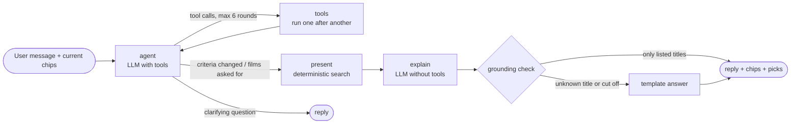

# CineSense

**Don't choose a movie. Choose a feeling.**

> Showcase link: coming soon (showcase.turingcollege.com)

## Goal

CineSense helps you pick a film by mood and personal constraints instead of scrolling through catalogues. Examples are "funny or action, in English, no horror", "something like Interstellar but shorter", or "what's in the cinema tonight vs. on my streaming services". It is a Turing College AI Engineering capstone project.

## Problem

Cinema and streaming sites show long title lists and genre grids. Combining several wishes (mood, original language, exclusions, cinema vs. streaming) is left to the user. The experience also feels like a database rather than going to the movies.

## How it works

- **A cinematic interface:** a 16:9 cinema screen with letterbox bars and curtains. Mood worlds fade across the screen, fog and projector light move in the background, and rows of film tiles drift past.
- **A chat agent:** a LangGraph ReAct agent with real tools turns free-text wishes into the same chips you can edit by hand, then explains the results. It can only name films the search engine actually returned (see *Agent* below).
- **One shared search state, shown as chips:** mood tags from the MovieLens Tag Genome, each weighted and set to *prefer*, *must* or *not* (e.g. 🚫 horror); plus person, title, plot and filter chips. Each result says why it matches ("dark 91% · plot: … · streaming on Netflix"), and excluded films are counted ("→ 214 films hidden").
- **Search that finds films several ways:** semantic plot search (RAG over Wikipedia plots in pgvector), weighted mood tags (movieFinder's method, computed in Postgres), typo- and sound-alike-tolerant title and actor/director search, and an extended live search for newer films (Streaming Availability API, Wikidata filmographies).
- **Where to watch:** streaming services in Germany (subscription vs. rent/buy) and recent German cinema releases.
- **Trailers on hover:** hovering a tile plays its trailer muted after half a second; one click unmutes.
- **It learns your taste:** 👍 / 👎 on a film's stage are remembered (anonymously, per browser). CineSense derives a taste profile from them (e.g. "dark · twist ending · space travel"), boosts films that fit ("fits your taste") and hides films you rejected. ⚡ More action and 😂 Funnier only steer the current session. The 👤 panel shows what was learned and resets it.
- **Genre page:** the chosen film is on stage with its poster, official trailer, people, mood tags, IMDb and Wikipedia links, with matching films below.

## Status

**Plans 1–5 are done:** the cinema UI runs on a real catalogue of about 20,600 films (≈19,800 from MovieLens incl. documentaries, plus ≈800 German releases since 2021). The chat agent works on the homepage and in the genre drawer. Personalisation works on the genre page and in all rankings. The evaluation results are below; see `docs/superpowers/plans/2026-10-29-cinesense-roadmap.md`.

## Setup

### With Docker (quickest)

```bash
cp .env.example .env          # Supabase, OpenRouter, Streaming Availability (YouTube optional)
docker compose up --build     # first build takes a few minutes
```

Then open **http://localhost:8080**. Three containers run: `api` (FastAPI), `web` (Next.js production build) and `proxy` (nginx), which serves both under one address (`/api` goes to the API, everything else to the web app). The catalogue is the existing Supabase (local on the host or in the cloud), so there is no database container; a `127.0.0.1` Supabase URL in `.env` is pointed at the host automatically. Building the catalogue (`make ingest`) still runs outside Docker, because it needs the local MovieLens file.

### Local development

Requirements: Python 3.12 with [uv](https://docs.astral.sh/uv/), and Node.js 20.19+.

```bash
cp .env.example .env          # Supabase, OpenRouter, Streaming Availability (YouTube optional)
uv sync                       # backend dependencies
make db-init                  # create the cinesense schema (pgvector, pg_trgm)
MOVIELENS_DB_PATH=/path/to/moviedoc.db make ingest   # ~1.5 h, ~$0.40 embeddings; resumable
cd web && npm install && cd ..
make dev-api                  # FastAPI on http://localhost:8000
make dev-web                  # Next.js on http://localhost:3000
make test                     # backend (pytest) + frontend (Vitest) tests
```

## Architecture

- **Backend:** Python, FastAPI and Pydantic, in `src/cinesense/`.
  - `domain`: the models and the six mood worlds
  - `providers`: data sources behind one interface (Postgres catalogue, offline fixture, streaming, live search, YouTube)
  - `recommend` / `search`: deterministic filters and the combined ranking
  - `agent`: the LangGraph chat agent
  - `api`: the HTTP layer
- **Frontend:** Next.js (App Router), TypeScript and Tailwind, in `web/`.
- **Data:** Supabase Postgres in its own `cinesense` schema — films, people, Tag Genome vectors (pgvector 1,128 dims), plot chunks with OpenRouter embeddings (pgvector 1,536 dims, HNSW), caches for streaming, images and trailers. The ingest lives in `src/cinesense/ingest/`.
- **Agent:** LangGraph + OpenRouter (default model `anthropic/claude-haiku-5.5`, set `CINESENSE_LLM_MODEL` to change it), traced in LangSmith when `LANGSMITH_TRACING=true`.

### Agent



The model decides **what** to look for; everything that must be reproducible is deterministic.

| The model decides (tools) | Deterministic code |
|---|---|
| `set_mood_tags` — Tag Genome tags with weight and prefer/must/not | ranking: weighted tag relevance, plot similarity, people, Bayesian rating |
| `set_filters` — cinema/streaming, runtime, kind, years, language, genres | hard filters and the "→ n films hidden" count |
| `search_plot` — RAG over Wikipedia plots | the final search run (`present`) and its top 8 |
| `find_person`, `similar_to` | API budgets (streaming 900/month, max 3 streaming checks per turn) |
| `check_streaming`, `film_facts` | grounding: the reply may only name returned films, else a template answer |
| `propose_exclusions` — suggested, never applied silently | "No horror" also excludes the Horror genre |
| `show_on_stage` — hand-off to the genre page | thread memory (one conversation per browser tab) |

**Personalisation:** the profile is computed on demand from the feedback: the average Tag Genome vector of the liked films minus the catalogue average (disliked films count against), reduced to the 8 strongest tags. It enters the ranking as a fifth signal (weight 0.15, scaled against the best film not yet rated), so mood, plot and people still lead.

The chat streams its progress (`POST /api/chat`, Server-Sent Events). A typical turn costs about 6,000 input and 800 output tokens; every turn's tokens are logged by the API.

The full design is in `docs/superpowers/specs/2026-10-29-cinesense-design.md`.

## Data and attribution

The curtain image is based on a photo by Ambitious Studio* | Rick Barrett on [Unsplash](https://unsplash.com/photos/a-red-curtain-with-a-black-background-AwsdyjRm-kw), cropped and colour-adjusted with `scripts/make_curtain.py`.

TMDB is **not** used: its API terms (1.C) forbid use "in connection with … an artificial intelligence (AI) based Application". Instead:

| Source | Used for | Licence |
|---|---|---|
| MovieLens (GroupLens) | ratings, genres, Tag Genome | research/education; not redistributed (read from a local file) |
| Wikidata | ids, people, runtime, language, German release, YouTube trailer ids | CC0 |
| Wikipedia | plot texts (RAG) | CC BY-SA 4.0, linked per film |
| Streaming Availability API (Movie of the Night) | streaming in Germany, posters | free plan, attribution; 1,000 requests/month with a budget guard |
| YouTube Data API (optional) | missing trailer ids | 100 searches/day, ids re-validated after 30 days |

All sources are credited on the in-app **Credits** page. No unlicensed sources are used, and nothing is scraped.

## Evaluation

`make eval` runs 36 scenarios through the real agent and catalogue: mood, "like X", runtime, exclusions, documentaries, people, plot, conflicting wishes, follow-ups, facts, ambiguous input, an unknown person, and two injected failures (Streaming Availability API down, embedding service down). Streaming data comes from the cache only in every scenario, so the run never spends API budget and also tests the "budget exhausted" path. Full results: [`eval/REPORT.md`](eval/REPORT.md); raw data in `eval/results/` (earlier runs are kept, including the ones where the checks themselves had bugs).

**Automatic metrics (final run).** Each rate counts only the scenarios that define the check:

| Metric | Result |
|---|---|
| Scenarios passing all checks | 36 / 36 |
| Constraint satisfaction (runtime, genres, kind, year, person, availability) | 19 / 19 |
| Tool selection (an expected tool was called) | 35 / 35 |
| Factual reply checks | 2 / 2 |
| No streaming claim without known availability | 36 / 36 |
| Grounding **before** the guard: the model's own explanation named only returned films | 31 / 36 (86%) |
| Grounding **after** the guard: what the user sees | 36 / 36 (5 template fallbacks) |
| Latency per scenario, median / p90 | 7.5 s / 12.3 s |
| Cost per chat turn (Claude Haiku 5.5) | $0.0011 |

"Tool success 100%" only means that no tool raised an exception. A degraded source (embeddings down) still returns a result, with weaker relevance.

**Ranking comparison.** 21 mood-tag scenarios, run with the criteria the agent set and identical hard filters for all three rankers:

| Ranker | Tag relevance@10 | Tag cosine@10 | Median MovieLens rating count | LLM judge 1–5 |
|---|---|---|---|---|
| Baseline A: filters + Bayesian rating | 0.34 | 0.05 | 35,000 | 1.52 |
| Baseline B: movieFinder (tag cosine + rating) | 0.79 | **0.20** | 1,118 | 3.67 |
| **CineSense** | **0.84** | 0.16 | 10,354 | **4.05** |

How to read the comparison:
- Each ranker wins on its own objective. *Tag relevance* (weighted mean of the requested tags) is what CineSense ranks by. *Tag cosine* is what movieFinder ranks by.
- The independent signal is the LLM judge (Claude Sonnet 5.5, subjective). It prefers CineSense (4.05 vs 3.67).
- The judge sees only titles and years, which may favour well-known films. CineSense's picks are clearly better known than movieFinder's (median 10,354 vs 1,118 ratings).
- The rating-only baseline ignores the wish.
- The judge gives the agent's own top 5 a mean of 3.97/5 over 31 scenarios.

The whole evaluation costs about $0.22: $0.04 for agent turns and $0.18 for the judge.

Limits of the evaluation:
- The automatic checks are narrow, and relevance is only judged subjectively.
- There are no scenarios for missing trailers or Wikidata/Wikipedia outages, because the agent's tools read the catalogue, not those sources, at chat time.
- The first runs found bugs in the checks themselves, all fixed with tests:
  - the mood tag "Creepy" is also a film title
  - a person outside the top-5 billed cast was not counted
  - a single-word title named by the user ("Alien") was flagged
- An independent review found a real defect: allowing all tag names had weakened the title guard. It was fixed before the final run.

## Ethics and privacy

- **No account, no personal data.** Personalisation uses a random UUID created in the browser (`localStorage`). The server stores only that id with film ids and 👍/👎 (`cinesense.feedback`). The 👤 panel shows everything that was learned and deletes it with one click. Chat history lives in server memory only for the running process. LangSmith traces (when enabled) contain the conversation, the chosen criteria, the taste tags and liked/disliked film ids, and a random per-tab conversation id, but not the user id. Chat messages go to the model provider through OpenRouter, so users should not type personal information.
- **Grounding instead of invented facts.** The agent never writes the recommendation list itself. A deterministic search returns real catalogue films, and the explanation may only name those films (or films the user named). Anything else, or an answer cut off mid-sentence, is replaced by a template answer built from the data. The explanation may also only say a film streams if the data confirms it. Direct answers without a result list (e.g. facts about one film) come from tool data but are not passed through the title check. Facts come from tools (`film_facts`, `check_streaming`) over Wikidata, Wikipedia and Movie of the Night. Unknown streaming availability is shown as "unknown", never guessed.
- **The user stays in control.** Every criterion the agent sets is visible and editable as a chip. Vague dislikes ("nothing too scary") are only *proposed* as exclusions, and excluded films are counted ("→ n films hidden"), so filtering is never silent.
- **Sources and licences.** Only licensed open data and an official API are used, credited per source (table above and the in-app Credits page). TMDB is excluded because its terms forbid AI applications. There are no piracy or streaming-link sites, and nothing is scraped.
- **Trailers.** They are official YouTube embeds via `youtube-nocookie.com`, started only by a deliberate hover of half a second. They start muted, with one click to unmute, and only one trailer plays at a time. Autoplay on hover is an interpretation of YouTube's embedding rules (the user acts first), not something the terms explicitly name.
- **Limits and bias.**
  - The Tag Genome covers mostly films up to about 2019 that were rated by MovieLens users, who skew towards English-language, US and older popular cinema.
  - Newer films (German releases since 2021, live imports) have no mood tags. They are found through plot, title and people, so mood searches favour older films.
  - Plot texts come from English Wikipedia, which covers non-English films less well.
  - The Bayesian rating dampens obscure films, so the ranking leans towards well-known titles.
  - The taste profile learns only from explicit 👍/👎, with no tracking of views or clicks.
